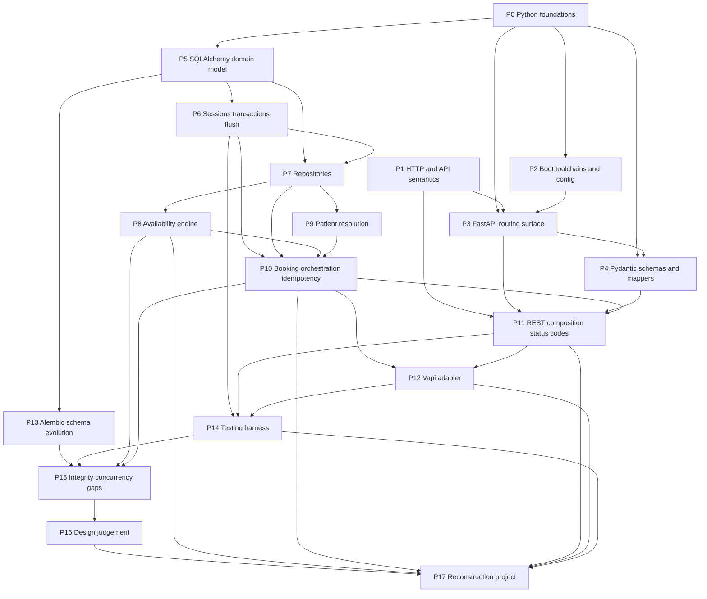

# Backend Engineering Curriculum: AI Booking MVP

**Course type:** Self-directed, project-based (Udemy-style structure)  
**Central lab:** this repository (`ai-booking-project`)  
**Design intent:** You study resources, investigate code, complete exercises, and self-assess. This blueprint does **not** teach lessons or solve exercises.

**How to use this document:** Work one phase at a time. For each phase: study the resources → investigate the named repository paths → complete the exercises → satisfy the exit criteria before moving on. Keep a learning journal of predictions vs. observations.

---

## 1. Verified architectural overview

### Purpose (verified)

Clinic-scoped appointment booking backend. Patients book via REST or a Vapi voice webhook. The system validates doctors/schedules, computes 30-minute availability, resolves patients by clinic+phone, creates appointments, and returns alternatives when slots fail. Idempotency keys prevent duplicate processing of the same request.

### Stack (verified from `pyproject.toml` / code)

| Layer | Technology |
| --- | --- |
| Language | Python ≥3.13 |
| API | FastAPI + Uvicorn |
| Validation | Pydantic v2 |
| ORM | SQLAlchemy 2.0 (`Mapped` / `mapped_column`) |
| Migrations | Alembic |
| DB | PostgreSQL (runtime); SQLite in-memory + `StaticPool` (tests) |
| Packaging | `uv` (`pyproject.toml` + `uv.lock`) |
| Tests | pytest + FastAPI `TestClient` |
| Voice adapter | Vapi webhook (`POST /vapi/webhook`) |

### What is **absent** (verified — omit or mark optional)

No authentication/authorization, background workers/queues, Docker/CI, seed scripts, `.env.example`, Redis/cache, or async route handlers. Do not center the curriculum on those.

### Entry points and HTTP surface

- App: [`app/main.py`](app/main.py) — `FastAPI` instance, router mounts, `/health`
- REST (prefix `/clinics/{clinic_id}`):
  - `GET /clinics/{clinic_id}/doctors`
  - `GET /clinics/{clinic_id}/doctors/{doctor_id}/availability`
  - `POST /clinics/{clinic_id}/bookings` (requires `Idempotency-Key` header)
- Adapter: [`app/api/routers/vapi.py`](app/api/routers/vapi.py) — tool-calls → same services (does **not** call REST routes)

### Layer map (verified)

```text
HTTP request
  → routers (validation boundaries, 404s, status codes)
  → deps.py (session + service wiring; commit/rollback)
  → services (BookingService, AvailabilityService, PatientResolutionService)
  → repositories (queries + flush)
  → SQLAlchemy models → DB
  → mappers + Pydantic schemas → response
```

### Critical domain flow (verified)

`BookingService.process_booking`: idempotency replay → insert `BookingRequest` → doctor check → `AvailabilityService` → **only if available** patient resolve → `Appointment` → link + `SUCCESS`; else `FAILED` + alternatives.

### Doc-vs-code gaps (learning gold — treat as investigation targets, not bugs to “fix” early)

- README/architecture claim DB enforces non-overlapping appointments; migrations/models have **indexes only**, no exclusion/`tstzrange` constraint.
- Business-rules doc: 7-day horizon, no past bookings, grid alignment — **not implemented** in services.
- Duration “per clinic config” in docs; code hardcodes 30 minutes.
- README says Vapi uses `call.id` for idempotency; code uses `args.idempotency_key` or `vapi-{toolCall.id}`.
- Dual `get_db`: real one in [`app/api/deps.py`](app/api/deps.py) (commit); unused-style helper in [`app/core/db.py`](app/core/db.py).

---

## 2. Prerequisite / phase dependency map



---

## 3. Course overview table

| Phase | Prerequisites | Main concepts | Repo focus | Practical milestone | Exit outcome |
| --- | --- | --- | --- | --- | --- |
| P0 | Basic Python | Typing, dataclasses, generators, UUID, datetime | Light file reading only | Mini scratch exercises | Can read service/model annotations without freezing |
| P1 | P0 | HTTP methods, status, headers, idempotency idea | Compare REST vs Vapi responses later | Predict status codes from scenarios | Can reason about 200/201/404/409 before FastAPI details |
| P2 | P0 | uv, env config, ASGI entry | `pyproject.toml`, `config.py`, `db.py`, `main.py` | Run pytest + explain live-server blockers | Can boot test path; document Postgres path |
| P3 | P1–P2 | Routers, path params, Depends intro | `main.py`, `doctors.py`, `deps` clinic/doctor | Trace list-doctors E2E | Explain one GET through layers |
| P4 | P3 | DTO vs ORM, unions, Field, mappers | `schemas/*`, `mappers/*` | Rebuild a mapper from a result object | Separate validation from persistence |
| P5 | P0, P2 | Declarative ORM, FKs, relationships | `models/*`, migrations skim | ER diagram from models alone | Explain six entities and BookingRequest vs Appointment |
| P6 | P5 | Engine, Session, flush vs commit, DI yield | `deps.get_db`, repos `flush` | Predict DB state after failure paths | Explain transaction ownership |
| P7 | P6 | Repository pattern, `select` | `repositories/*` | Implement a missing query in isolation | Write a typed repository method correctly |
| P8 | P7 | Interval overlap, free-slot scan | `availability_service.py` | Hand-compute + unit-test edge cases | Own the availability algorithm |
| P9 | P7 | Lookup-or-create, orphan prevention | `patient_resolution_service.py` | Prove ordering constraint with tests | Explain conditional patient creation |
| P10 | P8–P9, P6 | Orchestration, idempotency, status machine | `booking_service.py` | Full process_booking state machine writeup | Narrate all booking paths without code open |
| P11 | P4, P10 | Router orchestration, headers, status | `bookings.py`, `availability.py` | Dual idempotency-check analysis | Explain REST contract vs service result |
| P12 | P11 | Adapter pattern, webhook payloads | `vapi.py` | Map tools to services; idempotency key rules | Explain voice path without claiming it uses REST |
| P13 | P5 | Migrations, schema evolution | `alembic/*` | Replay migration story | Explain why end_time left the request table |
| P14 | P6, P11–P12 | Fixtures, TestClient, overrides | `tests/**`, `conftest.py` | Write a new integration test for a gap | Extend suite without copying blindly |
| P15 | P13–P14, P8, P10 | Constraints vs app checks, races | docs vs schema vs code | Gap matrix + race predictions | Know what tests do **not** prove |
| P16 | P15 | Trade-offs, when to change code | Whole system | Design memo + optional small change | Justify change or deliberate non-change |
| P17 | All prior | Full-stack reconstruction | Blank project | Rebuild essential booking backend | Independent comparable system |

---

## 4. Ordered phases (full blueprint)

### Phase 0 — Python mechanisms this repo assumes

**A. Purpose and learning outcomes**

Remove language friction before frameworks. After this phase you can read `Mapped[...]`, `Optional`, `@dataclass`, `yield` dependencies, and UUID/datetime usage in this codebase without freezing on syntax.

**B. Prerequisites**

Comfortable writing basic Python (functions, classes, imports). No FastAPI or SQLAlchemy required yet.

**C. Concepts and mechanisms**

- General: type hints & `| None`; dataclasses; generators/`yield` teardown; `uuid`; naive vs aware `datetime`; modules/packages/`__init__.py`.
- Repo-specific: service result dataclasses; generator-based session dependencies (preview).

**D. Repository investigation (light)**

Skim annotations in [`app/services/booking_service.py`](app/services/booking_service.py), [`app/services/availability_service.py`](app/services/availability_service.py), one model under [`app/models/`](app/models/), and `get_db` in [`app/api/deps.py`](app/api/deps.py). Do not deep-dive behavior yet.

**E. Learning resources**

| Resource | URL | Study | Why |
| --- | --- | --- | --- |
| Python typing | https://docs.python.org/3/library/typing.html | `Optional`, `Literal`, `TYPE_CHECKING` | Matches annotations in models/services |
| dataclasses | https://docs.python.org/3/library/dataclasses.html | full basics | `BookingResult` / `AvailabilityResult` |
| Generators | https://docs.python.org/3/howto/functional.html#generators | generators section | Mental model for `yield` in `get_db` |
| datetime | https://docs.python.org/3/library/datetime.html | aware vs naive | Vapi strips tzinfo; models use naive times |
| uuid | https://docs.python.org/3/library/uuid.html | `uuid4` | All entity PKs |

**F. Practical exercises**

1. **Implementation:** Reimplement `BookingResult` / `AvailabilityResult` as plain dataclasses in a scratch file (do not modify the app).
2. **Mechanism:** Write a mini `with`-like resource using `yield` that commits/rolls back a fake counter.
3. **Mechanism:** Convert a Zulu ISO string to UTC then strip tzinfo; document what type remains.

**Deliverables:** Scratch files + short notes.  
**Acceptance:** You can explain generator teardown and why services return dataclasses (not ORM objects) to HTTP.

**G. Mastery / exit criteria**

Closed-book: explain generator teardown and DTO-vs-ORM return choice. Flush/commit deep understanding is **not** required yet (Phase 6).

---

### Phase 1 — HTTP and API semantics (framework-agnostic)

**A. Purpose and learning outcomes**

Status codes and idempotency are product behavior here; learn them before FastAPI hides them. Predict 200/201/404/409/422-class outcomes for booking scenarios; distinguish HTTP method idempotency from domain `Idempotency-Key` headers.

**B. Prerequisites**

Phase 0.

**C. Concepts**

HTTP methods; status classes; headers; JSON bodies; REST resource thinking; safe vs idempotent methods.

**D. Repository investigation**

Read the README “Production Safety & Status Codes” section. Later verify against [`app/api/routers/bookings.py`](app/api/routers/bookings.py) (do not deep-dive FastAPI yet).

**E. Learning resources**

| Resource | URL | Study | Why |
| --- | --- | --- | --- |
| HTTP methods | https://developer.mozilla.org/en-US/docs/Web/HTTP/Reference/Methods | full page; safe/idempotent table | GET vs POST semantics |
| Status codes | https://developer.mozilla.org/en-US/docs/Web/HTTP/Reference/Status | 200, 201, 400, 404, 409, 422, 500 | Matches this API’s contract |
| REST glossary | https://developer.mozilla.org/en-US/docs/Glossary/REST | full | Resource framing for clinic-scoped routes |

**F. Practical exercises**

Build a scenario prediction table for: missing clinic; wrong-clinic doctor; free slot first booking; same `Idempotency-Key` success replay; unavailable slot; missing idempotency header → predicted status + body shape.

**Deliverable:** Written table (revise after Phase 11).  
**Acceptance:** ≥5/6 scenarios correct before reading FastAPI status-code docs.

**G. Exit criteria**

You can define domain idempotency keys vs HTTP idempotent methods in your own words.

---

### Phase 2 — Toolchain, configuration, process model

**A. Purpose and outcomes**

Understand how the process starts and why tests ≠ production DB. Run `uv sync` + `pytest` green; explain import-time engine creation; list live-server prerequisites.

**B. Prerequisites**

Phase 0.

**C. Concepts**

Virtualenvs/lockfiles; env vars; ASGI/Uvicorn; settings objects; dual DB story (SQLite tests vs Postgres runtime).

**D. Repository investigation**

[`pyproject.toml`](pyproject.toml), [`app/core/config.py`](app/core/config.py), [`app/core/db.py`](app/core/db.py), [`app/main.py`](app/main.py), [`app/tests/conftest.py`](app/tests/conftest.py), [`alembic/env.py`](alembic/env.py).

**E. Learning resources**

| Resource | URL | Study | Why |
| --- | --- | --- | --- |
| uv projects | https://docs.astral.sh/uv/guides/projects/ | sync, lock, run | This repo uses uv |
| python-dotenv | https://saurabh-kumar.com/python-dotenv/ | `load_dotenv` usage | [`config.py`](app/core/config.py) |
| Uvicorn | https://www.uvicorn.org/ | running apps | ASGI server for FastAPI |
| FastAPI first steps | https://fastapi.tiangolo.com/tutorial/first-steps/ | app instance + run | Entrypoint mental model |

**F. Practical exercises**

1. Boot investigation writeup: what fails without `DATABASE_URL`.
2. Diff `get_db` in `deps.py` vs `core/db.py`.
3. Trace why `conftest` overrides `deps.get_db`.

**Deliverable:** 1-page “how to run tests vs how to run server.”  
**Acceptance:** Full pytest green; three blockers for real bookings named (env, migrations, seed data).

**G. Exit criteria**

Articulate why the test suite works without Postgres and what is still missing for `uvicorn` bookings.

---

### Phase 3 — FastAPI routing surface (start with list doctors)

**A. Purpose and outcomes**

Learn the framework request path on the simplest real endpoint. Trace `GET /clinics/{clinic_id}/doctors` closed-book through router → repo → response.

**B. Prerequisites**

Phases 1–2.

**C. Concepts**

- Framework: path operations; path params; `APIRouter` / `include_router`; `HTTPException`; intro `Depends`; OpenAPI `/docs`.
- App-specific: clinic-scoped prefix; 404 ownership in the router.

**D. Repository investigation**

[`app/main.py`](app/main.py), [`app/api/routers/doctors.py`](app/api/routers/doctors.py), clinic/doctor repositories, [`app/schemas/doctor.py`](app/schemas/doctor.py), [`app/api/deps.py`](app/api/deps.py) factory functions used by doctors.

**E. Learning resources**

| Resource | URL | Study | Why |
| --- | --- | --- | --- |
| Path params | https://fastapi.tiangolo.com/tutorial/path-params/ | full | `clinic_id` |
| Query params | https://fastapi.tiangolo.com/tutorial/query-params/ | full | Needed later for availability |
| Bigger applications | https://fastapi.tiangolo.com/tutorial/bigger-applications/ | routers / includes | Matches `main.py` |
| Dependencies | https://fastapi.tiangolo.com/tutorial/dependencies/ | first steps + shared deps | `Depends(...)` wiring |
| Handling errors | https://fastapi.tiangolo.com/tutorial/handling-errors/ | `HTTPException` | Clinic/doctor 404s |

**F. Practical exercises**

1. **Investigation:** Execution-path diagram for list doctors.
2. **Prediction:** 404 cases; confirm via [`app/tests/integration/test_api_failures.py`](app/tests/integration/test_api_failures.py).
3. **Transfer (design only):** `GET /clinics/{id}` returning clinic name using the same patterns — do not require implementing in the app yet.

**G. Exit criteria**

Oral/written walkthrough without opening files for more than ~30s at a time; explain why the clinic check lives in the router.

---

### Phase 4 — Pydantic schemas, validation, mappers

**A. Purpose and outcomes**

Separate wire DTOs from ORM; understand response shaping. Explain `CreateBookingRequest` vs `BookingResponse` union; rebuild a mapper.

**B. Prerequisites**

Phase 3.

**C. Concepts**

`BaseModel`, `Field`, `Literal`, union response types, `ConfigDict(from_attributes=True)`, mapper functions vs fat routers.

**D. Repository investigation**

[`app/schemas/booking.py`](app/schemas/booking.py), [`app/schemas/availability.py`](app/schemas/availability.py), [`app/schemas/common.py`](app/schemas/common.py), [`app/api/mappers/`](app/api/mappers/).

**E. Learning resources**

| Resource | URL | Study | Why |
| --- | --- | --- | --- |
| Pydantic models | https://docs.pydantic.dev/latest/concepts/models/ | models + validation | Request/response DTOs |
| Fields | https://docs.pydantic.dev/latest/concepts/fields/ | `Field` constraints | `min_length` on booking body |
| FastAPI body | https://fastapi.tiangolo.com/tutorial/body/ | full | `CreateBookingRequest` |
| Response model | https://fastapi.tiangolo.com/tutorial/response-model/ | full | `response_model=` on routes |

**F. Practical exercises**

1. Without looking at the mapper, write `booking_response` from `BookingResult` in a scratch module; compare to [`app/api/mappers/booking.py`](app/api/mappers/booking.py).
2. List which invalid bodies yield validation errors vs domain 409s.
3. **Design evaluation:** why mappers exist instead of returning ORM directly.

**G. Exit criteria**

Correctly classify 3 failing payloads as validation vs domain; produce a working scratch mapper.

---

### Phase 5 — Domain model and relational design

**A. Purpose and outcomes**

Persistence shape drives every service. Produce an accurate ER diagram; articulate BookingRequest (intent + idempotency) vs Appointment (confirmed fact).

**B. Prerequisites**

Phases 0 and 2.

**C. Concepts**

- Backend: tables/PK/FK/indexes/unique.
- Framework: ORM declarative mapping; `relationship`/`back_populates`.
- App-specific: UUID keys; status as strings (no DB enum type).

**D. Repository investigation**

All of [`app/models/`](app/models/), [`app/verify_models.py`](app/verify_models.py), skim [`alembic/versions/5821251d4c37_initial_schema.py`](alembic/versions/5821251d4c37_initial_schema.py).

**E. Learning resources**

| Resource | URL | Study | Why |
| --- | --- | --- | --- |
| ORM quick start | https://docs.sqlalchemy.org/en/20/orm/quickstart.html | full | Declarative style used here |
| Declarative / `mapped_column` | https://docs.sqlalchemy.org/en/20/orm/declarative_tables.html | mapped_column + Mapped | Exact model style |
| Relationships | https://docs.sqlalchemy.org/en/20/orm/basic_relationships.html | one-to-many / back_populates | Clinic↔Doctor↔… |
| PostgreSQL constraints | https://www.postgresql.org/docs/current/ddl-constraints.html | PK/FK/UNIQUE | Exclusion later in P15 |

**F. Practical exercises**

1. ER diagram from models only.
2. Mechanism: what `appointment_id` null vs set means on a booking request.
3. Note `Clinic.py` filename vs `clinic` import — explain risk on case-sensitive OS.
4. Inventory indexes/uniques actually present in models/migrations.

**G. Exit criteria**

Closed-book entity responsibilities; list verified constraints vs assumed ones.

---

### Phase 6 — Sessions, transactions, flush vs commit

**A. Purpose and outcomes**

This repo’s correctness hinges on session lifecycle in `deps.get_db`. Explain who commits; why repos `flush`; what persists on FAILED bookings.

**B. Prerequisites**

Phase 5.

**C. Concepts**

Engine/sessionmaker; unit-of-work; flush visibility; commit/rollback; dependency `yield`; request-scoped session; FastAPI dependency caching.

**D. Repository investigation**

[`app/api/deps.py`](app/api/deps.py) `get_db`, repository `flush` calls, integration tests that assert DB counts (e.g. [`app/tests/integration/test_api_database_state.py`](app/tests/integration/test_api_database_state.py)).

**E. Learning resources**

| Resource | URL | Study | Why |
| --- | --- | --- | --- |
| Session basics | https://docs.sqlalchemy.org/en/20/orm/session_basics.html | session lifecycle | Unit of work |
| Session transaction | https://docs.sqlalchemy.org/en/20/orm/session_transaction.html | flush vs commit | Matches repo `flush` + deps commit |
| Dependencies with yield | https://fastapi.tiangolo.com/tutorial/dependencies/dependencies-with-yield/ | full | `get_db` pattern |
| FastAPI SQL databases | https://fastapi.tiangolo.com/tutorial/sql-databases/ | pattern comparison | Contrast with this repo’s wiring |

**F. Practical exercises**

1. Predict rows after successful booking vs unavailable booking vs exception mid-handler.
2. Explain why tests `flush` in the override instead of commit.
3. Mechanism: two `Depends` sharing `get_db` — one session or two? Prove from FastAPI dependency caching docs + code.

**G. Exit criteria**

Correct predictions for three lifecycle scenarios; explain the dual `get_db` hazard (`deps.py` vs `core/db.py`).

---

### Phase 7 — Repository layer

**A. Purpose and outcomes**

All SQL lives here; services stay orchestration/algorithms. Implement a repository query matching project style; explain overlap query predicates.

**B. Prerequisites**

Phase 6.

**C. Concepts**

Repository pattern; `select` / `scalars` / `db.get`; range overlap SQL (`start < end AND end > start`).

**D. Repository investigation**

All of [`app/repositories/`](app/repositories/), especially appointment, schedule, booking_request, and patient repositories. Compare method names to the contracts listed in [`app/docs/SYSTEM_BEHAVIOUR_DESIGN.md`](app/docs/SYSTEM_BEHAVIOUR_DESIGN.md) §7.

**E. Learning resources**

| Resource | URL | Study | Why |
| --- | --- | --- | --- |
| Select tutorial | https://docs.sqlalchemy.org/en/20/tutorial/data_select.html | Core select | Statement style used in repos |
| ORM query guide | https://docs.sqlalchemy.org/en/20/orm/queryguide/index.html | selecting ORM objects | `scalars().all()` / `.first()` |

**F. Practical exercises**

1. Trace `get_for_doctor_in_range` and explain the overlap inequalities.
2. In a **scratch** module, write `BookingRequestRepository.get_by_idempotency_key` from the signature alone; compare.
3. Catalog doc-listed repo methods that do not exist in code.

**G. Exit criteria**

Independently write one correct repository method; map doc contracts vs real methods.

---

### Phase 8 — Availability engine (core algorithm)

**A. Purpose and outcomes**

Domain heart: Schedule − Appointments + alternatives. Hand-simulate results; identify schedule-containment ambiguity; write tests for edges.

**B. Prerequisites**

Phase 7.

**C. Concepts**

Interval overlap; free-list scanning; hardcoded 30-minute duration; app-level vs DB-level enforcement (preview of Phase 15).

**D. Repository investigation**

[`app/services/availability_service.py`](app/services/availability_service.py), schedule/appointment repositories, [`app/tests/unit/test_availability_service.py`](app/tests/unit/test_availability_service.py), availability router/mapper for response shape.

**E. Learning resources**

| Resource | URL | Study | Why |
| --- | --- | --- | --- |
| Prior notes + property tests | (your Phase 1–7 journal) | overlap properties | Core algorithm is custom |
| PostgreSQL range types (optional) | https://www.postgresql.org/docs/current/rangetypes.html | conceptual skim | Prep for P15 exclusion constraints |
| Re-read SQLAlchemy select docs | as needed | — | Repository inputs to the service |

**F. Practical exercises**

1. For schedule 09:00–17:00 and appointment 10:00–10:30, compute availability for 09:00, 10:00, 10:15, 16:45.
2. Does the code require the full 30-min window inside a schedule block? Design an experiment/test.
3. Reimplement `_find_alternative_slots` in isolation without looking; compare.
4. **Transfer:** adapt the algorithm to 15-minute duration on paper.

**G. Exit criteria**

Pass your own edge-case tests; written answer on schedule-containment behavior (**observed**, not wished).

---

### Phase 9 — Patient resolution

**A. Purpose and outcomes**

Identity side-effect ordering is a deliberate invariant. Explain lookup key; why create-after-availability; race without unique constraint (preview Phase 15).

**B. Prerequisites**

Phase 7 (Phase 8 recommended before Phase 10, but patient service can be studied after repos).

**C. Concepts**

Lookup-or-create; conditional side effects; orphan-record prevention; natural key (clinic + phone).

**D. Repository investigation**

[`app/services/patient_resolution_service.py`](app/services/patient_resolution_service.py), [`app/repositories/patient_repository.py`](app/repositories/patient_repository.py), patient-related cases in [`app/tests/integration/test_api_database_state.py`](app/tests/integration/test_api_database_state.py) and [`app/tests/unit/test_patient_resolution_service.py`](app/tests/unit/test_patient_resolution_service.py). Business-rules doc patient section as **intent only**: [`app/docs/BUSINESS_RULES_&_SCHEDULING_POLICY.md`](app/docs/BUSINESS_RULES_&_SCHEDULING_POLICY.md).

**E. Learning resources**

Reuse SQLAlchemy + prior phases. No new primary framework docs required.

**F. Practical exercises**

1. Trace where `resolve` is called relative to availability in `process_booking`.
2. Explain existing tests for no patient on failure / reuse on success.
3. Design evaluation: unique `(clinic_id, phone)` — benefits/costs vs current code.

**G. Exit criteria**

Closed-book sequence diagram including patient-create timing.

---

### Phase 10 — Booking orchestration and idempotency

**A. Purpose and outcomes**

Compose prior pieces into the system’s main use case. Full state machine of `BookingRequest.status`; all return paths; idempotent replay semantics.

**B. Prerequisites**

Phases 6, 8, 9.

**C. Concepts**

Application service / orchestrator; idempotency keys; deterministic replay; status lifecycle `RECEIVED` → `PROCESSING` → `SUCCESS` | `FAILED`.

**D. Repository investigation**

[`app/services/booking_service.py`](app/services/booking_service.py), booking_request repo/model, [`app/tests/unit/test_booking_service.py`](app/tests/unit/test_booking_service.py), booking-related integration tests.

**E. Learning resources**

| Resource | URL | Study | Why |
| --- | --- | --- | --- |
| FastAPI header params | https://fastapi.tiangolo.com/tutorial/header-params/ | full | Prep for P11 `Idempotency-Key` |
| Stripe idempotent requests | https://docs.stripe.com/api/idempotent_requests | concepts only | Domain idempotency ideas (not Stripe APIs) |

**F. Practical exercises**

1. Draw the state machine from **code** (not docs).
2. Predict same-key different-payload behavior; verify with existing tests.
3. Implement `process_booking` in a scratch file against fake repos (interfaces only); compare decision order.
4. If doctor is missing after the request is inserted — what status remains?

**G. Exit criteria**

Narrate happy / replay / fail paths with tables touched; no open code.

---

### Phase 11 — REST composition, headers, status codes

**A. Purpose and outcomes**

Connect HTTP contract to service results; spot dual idempotency checks. Explain 201 vs 200 vs 409 mapping; why the router checks clinic/doctor before the service.

**B. Prerequisites**

Phases 4 and 10.

**C. Concepts**

Router orchestration; required headers; mutable `Response.status_code`; mapping service results to HTTP.

**D. Repository investigation**

[`app/api/routers/bookings.py`](app/api/routers/bookings.py), [`app/api/routers/availability.py`](app/api/routers/availability.py), mappers, [`app/tests/integration/test_api_workflow.py`](app/tests/integration/test_api_workflow.py), failure/validation tests.

**E. Learning resources**

| Resource | URL | Study | Why |
| --- | --- | --- | --- |
| Response status code | https://fastapi.tiangolo.com/tutorial/response-status-code/ | full | Default 201 on create |
| Additional status codes | https://fastapi.tiangolo.com/advanced/additional-status-codes/ | full | Dynamic 200/409 |

**F. Practical exercises**

1. Router idempotency lookup vs service lookup — redundant? harmful?
2. On paper, redesign status mapping if FAILED replay should differ.
3. Given a 409 body, list SQL rows you expect.
4. **Transfer:** specify a REST contract for cancel-appointment using the same layering (design only).

**G. Exit criteria**

Accurate status-code matrix matching tests; written analysis of the dual idempotency check.

---

### Phase 12 — Vapi webhook adapter

**A. Purpose and outcomes**

Learn the adapter / anti-corruption pattern without confusing it for a second domain. Map three tools to services; explain error-in-body vs HTTP errors; state the correct idempotency key rule from code.

**B. Prerequisites**

Phase 11.

**C. Concepts**

- Backend: adapter pattern; webhook contracts; vendor payload parsing.
- App-specific: `tool-calls` message type; tools `list_doctors`, `check_availability`, `create_booking`; datetime normalization in `_parse_datetime`.

**D. Repository investigation**

[`app/api/routers/vapi.py`](app/api/routers/vapi.py), [`app/tests/integration/test_vapi_webhook.py`](app/tests/integration/test_vapi_webhook.py), README voice/idempotency claims vs code.

**E. Learning resources**

| Resource | URL | Study | Why |
| --- | --- | --- | --- |
| FastAPI request body | https://fastapi.tiangolo.com/tutorial/body/ | dict / JSON bodies | Webhook accepts `Dict[str, Any]` |
| Python json | https://docs.python.org/3/library/json.html | `loads` | Arguments may arrive as JSON strings |
| Vapi function tools | https://docs.vapi.ai/tools/custom-tools | creating tools, server URL, request/response shape | How Vapi invokes your webhook |
| Vapi tools troubleshooting | https://docs.vapi.ai/tools/custom-tools-troubleshooting | response format, HTTP 200 + `results[]`, `toolCallId`, sync vs async | Matches this adapter’s return shape |
| Vapi server URLs | https://docs.vapi.ai/server-url/setting-server-urls | URL priority (tool → assistant → phone → account) | Where to point ngrok/`/vapi/webhook` |
| Vapi server message API | https://docs.vapi.ai/api-reference/webhooks/server-message | `tool-calls` message type and expected responses | Payload contract for Phase 12 |

Treat vendor docs as **adapter contract**, not domain truth. Timebox reading; the domain remains `BookingService` / `AvailabilityService`.

**F. Practical exercises**

1. Table: tool → validations → service → result shape.
2. Non-`tool-calls` message behavior.
3. Idempotency: new `toolCall.id` vs reused key (and contrast with README’s `call.id` claim).
4. Design essay (≤400 words): should the webhook call REST internally?
5. **Transfer:** invent a `cancel_booking` tool contract on paper consistent with this adapter style.

**G. Exit criteria**

Explain the voice path end-to-end; list three README inaccuracies you verified against code.

---

### Phase 13 — Alembic and schema evolution

**A. Purpose and outcomes**

Understand how the schema arrived at “end time computed, appointment linked.” Narrate three migrations; explain autogenerate role via `env.py` metadata.

**B. Prerequisites**

Phase 5.

**C. Concepts**

Migration environments; revision chain; upgrade/downgrade; autogenerate vs hand-written; `create_all` vs migrations.

**D. Repository investigation**

[`alembic/env.py`](alembic/env.py),  
[`alembic/versions/5821251d4c37_initial_schema.py`](alembic/versions/5821251d4c37_initial_schema.py),  
[`alembic/versions/448b90860c1e_remove_requested_date_and_link_.py`](alembic/versions/448b90860c1e_remove_requested_date_and_link_.py),  
[`alembic/versions/e656effc189d_make_doctor_id_required_and_remove_.py`](alembic/versions/e656effc189d_make_doctor_id_required_and_remove_.py),  
models after those changes.

**E. Learning resources**

| Resource | URL | Study | Why |
| --- | --- | --- | --- |
| Alembic tutorial | https://alembic.sqlalchemy.org/en/latest/tutorial.html | environment, revisions, upgrade/downgrade | Matches this repo’s Alembic layout |
| Autogenerate | https://alembic.sqlalchemy.org/en/latest/autogenerate.html | `target_metadata`, review step | [`alembic/env.py`](alembic/env.py) wires `Base.metadata` |

**F. Practical exercises**

1. Timeline: initial columns → what disappeared/appeared.
2. Why drop `requested_end_time` given the 30-min rule.
3. Scratch: write a hypothetical migration adding unique `(clinic_id, phone)` — do not apply to a shared DB until Phase 16.
4. Compare tests’ `create_all` vs migrations for production.

**G. Exit criteria**

Explain the migration chain closed-book; know when `create_all` is insufficient for production.

---

### Phase 14 — Testing as an engineering skill

**A. Purpose and outcomes**

Tests are how you modify safely; learn the harness deeply. Add a meaningful failing-then-passing (or characterization) test; explain isolation strategy.

**B. Prerequisites**

Phases 6, 11–12.

**C. Concepts**

Fixtures/scopes; `TestClient`; `dependency_overrides`; arrange-act-assert; unit vs integration boundaries in this repo.

**D. Repository investigation**

[`app/tests/conftest.py`](app/tests/conftest.py), all files under [`app/tests/`](app/tests/).

**E. Learning resources**

| Resource | URL | Study | Why |
| --- | --- | --- | --- |
| pytest fixtures | https://docs.pytest.org/en/stable/how-to/fixtures.html | requesting fixtures, scopes, teardown | `conftest.py` factories |
| FastAPI testing | https://fastapi.tiangolo.com/tutorial/testing/ | `TestClient`, overrides | Exact pattern used here |
| pytest assertions | https://docs.pytest.org/en/stable/how-to/assert.html | assert rewriting | Writing clear failures |

**F. Practical exercises**

1. Why `StaticPool` + in-memory SQLite.
2. Coverage map: concurrency, timezone, schedule containment, unique phone — which are untested?
3. Write a new test that catches one gap **or** documents current behavior as intentional characterization.
4. Break a mapper deliberately and record which tests fail (failure chain).

**G. Exit criteria**

A merged-quality test on your branch with a clear name and assertions; explain what the suite does **not** guarantee.

---

### Phase 15 — Integrity, concurrency, and honesty about guarantees

**A. Purpose and outcomes**

Build judgement about app checks vs DB constraints. Produce a living “implemented vs intended” matrix; predict races for dual booking and dual idempotency insert.

**B. Prerequisites**

Phases 8, 10, 13–14.

**C. Concepts**

Optimistic checks; unique violations; exclusion constraints; TOCTOU; SQLite vs Postgres test fidelity; missing `IntegrityError` handling.

**D. Repository investigation**

Appointments model/migrations; patient unique absence; `process_booking`; architecture/README claims; absence of overlap exclusion constraints.

**E. Learning resources**

| Resource | URL | Study | Why |
| --- | --- | --- | --- |
| Exclusion constraints | https://www.postgresql.org/docs/current/ddl-constraints.html#DDL-CONSTRAINTS-EXCLUSION | exclusion section | What docs claim but code lacks |
| Range types + constraints | https://www.postgresql.org/docs/current/rangetypes.html#RANGETYPES-CONSTRAINT | non-overlapping examples | Doctor-slot integrity pattern |
| SQLAlchemy exceptions | https://docs.sqlalchemy.org/en/20/core/exceptions.html | `IntegrityError` | Concurrent idempotency key races |

**F. Practical exercises**

1. Gap matrix: documented / implemented / tested / enforced-at-DB.
2. Predict concurrent same-key insert outcome.
3. Predict concurrent different-key same-slot outcome under the current schema.
4. Design evaluation: exclusion constraint vs advisory lock vs serializable — justify one for **this** MVP.

**G. Exit criteria**

Matrix complete; two race writeups with expected failure modes. Implementation not required yet.

---

### Phase 16 — Design judgement and deliberate change

**A. Purpose and outcomes**

Transition from understanding to owning modifications. One justified change **or** a written ADR to leave behavior as-is; blast-radius analysis (REST + Vapi share services).

**B. Prerequisites**

Phase 15.

**C. Concepts**

ADR-style decision records; characterization vs regression tests; blast radius; YAGNI vs documented promises.

**D. Repository investigation**

Whole system + [`app/docs/`](app/docs/) as historical intent.

**E. Learning resources**

| Resource | URL | Study | Why |
| --- | --- | --- | --- |
| Architecture Decision Records | https://cognitect.com/blog/2011/11/15/documenting-architecture-decisions | full short essay | Template for your Phase 16 memo |
| Revisit Stripe idempotency / Postgres exclusion | prior URLs | as needed | Support your chosen track |

**F. Practical exercises (pick one track)**

- **A Harden:** one integrity improvement with migration + tests (Postgres-aware if claiming DB enforcement).
- **B Correct availability:** enforce full-window-inside-schedule with tests; update docs.
- **C Ops enablement:** seed script + README runbook for local Postgres booking (Docker optional).
- **D Adapter cleanup:** reduce duplication between Vapi and REST without breaking tests.

**G. Exit criteria**

ADR + tests green + demo script; explain what you refused to “clean up.”

---

### Phase 17 — Cumulative reconstruction project

**A. Purpose and outcomes**

Prove transferable backend competence by rebuilding essential capabilities from a blank project.

**B. Prerequisites**

All prior phases. Do not start early.

**C. Constraint**

New directory/repo; **do not copy-paste** this codebase. You may keep the original open for behavioral reference and acceptance checks only.

**D. Milestones**

1. **Skeleton:** uv project, FastAPI app, `/health`, settings, DB session dependency with commit/rollback.
2. **Model + migrate:** Clinic, Doctor, Patient, Schedule, Appointment, BookingRequest with the invariants **you** choose (document deviations).
3. **Repositories + availability:** port the algorithm with your tests; fix schedule-containment if you judged it a defect.
4. **Booking + patient + idempotency:** full orchestrator; HTTP statuses match an acceptance table you write first.
5. **Adapter:** webhook or second client protocol with the same services (may simplify the Vapi payload but must preserve tool separation).
6. **Hardening:** at least one DB-enforced invariant (unique phone or exclusion overlap) + `IntegrityError` handling path.
7. **Test suite:** unit for availability + patient; integration for happy path, replay, conflict, validation.

**E. Final competency assessment (self-administered)**

Produce a portfolio packet:

1. Demo recording or scripted HTTP session (list doctors → availability → book → replay → conflict).
2. Architecture one-pager with sequence diagram.
3. Decision log (duration policy, idempotency key strategy, DB constraints).
4. Test report (`pytest -v`) and coverage of failure cases.
5. Oral checklist (answer without code):
   - flush vs commit ownership
   - why BookingRequest exists
   - what concurrent double-book does in **your** system
   - how the adapter differs from REST
6. Transfer task: `reschedule_appointment` design + stubbed tests proving you can extend **your** system.

**Pass bar:** Essential booking capabilities work; mechanisms explained; decisions justified; tests catch the important failures; you can extend without the original repo.

---

## 5. Recommended independent workflow

1. One phase at a time; do not skip P6 / P8 / P10 — later phases collapse without them.
2. For each phase: resources → repo investigation → exercises → written exit answers → only then next phase.
3. Keep a learning journal: predictions before reading code; corrections after.
4. Prefer characterization tests when behavior is unclear; do not “fix” doc gaps before P15–P16.
5. Timebox vendor docs (Vapi); domain truth is this backend.
6. When stuck: isolate the mechanism in a ~20-line scratch file, then return to the repo path named in the phase.
7. Weekly checkpoint: narrate `create_booking` aloud; if you cannot, return to P10/P11.

**Suggested cadence:** P0–P2 (few days), P3–P7 (~1–2 weeks), P8–P12 (~1–2 weeks), P13–P16 (~1 week), P17 (1–2 weeks). Adjust to prior experience; do not rush reconstruction.

---

## 6. Scope honesty / optional topics

| Topic | Status in curriculum |
| --- | --- |
| AuthN/AuthZ | Out of scope (not in repo); optional appendix after P17 |
| Async SQLAlchemy / async routes | Optional appendix — repo is sync |
| Docker/CI/observability | Optional after P16 ops track |
| Advanced FastAPI security utilities | Skip until you add auth |
| Celery/queues | Skip |

---

## 7. Design-quality checklist (blueprint self-review)

- Sequence follows repo dependencies (HTTP → routing → schemas → models → sessions → repos → availability → patient → booking → REST → Vapi → migrations → tests → integrity → judgement → rebuild).
- Every major subsystem covered: routers, deps, schemas/mappers, models, repos, three services, alembic, tests, webhook.
- Resources are official/primary with specific sections and direct URLs.
- Exercises demand investigation, prediction, reconstruction, and design — not CRUD busywork.
- Final reconstruction consumes P6–P15 skills explicitly.
- Doc-vs-code gaps used as curriculum content, not early “fix everything” mandates.

---

## 8. Quick start (Phase 0 / Phase 2)

```bash
# From repo root
uv sync
uv run pytest
```

Then open this file at **Phase 0** and begin. Do not start Phase 17 until exit criteria for Phases 0–16 are met.
